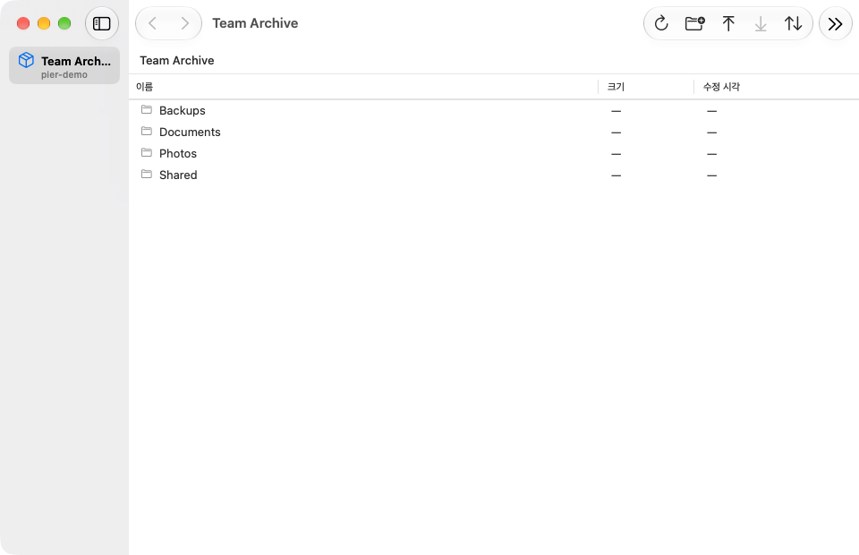
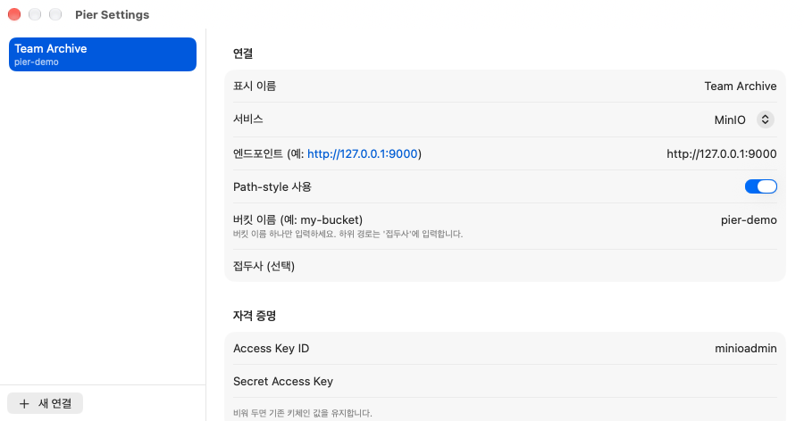
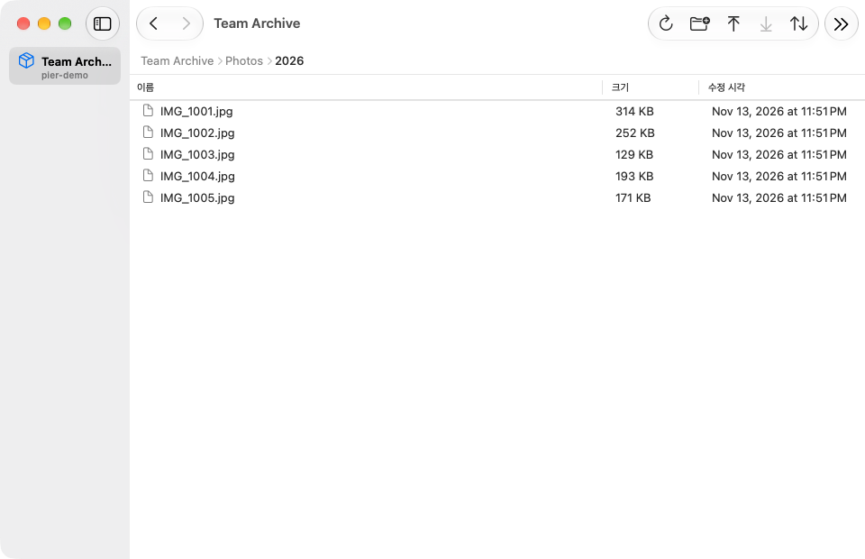
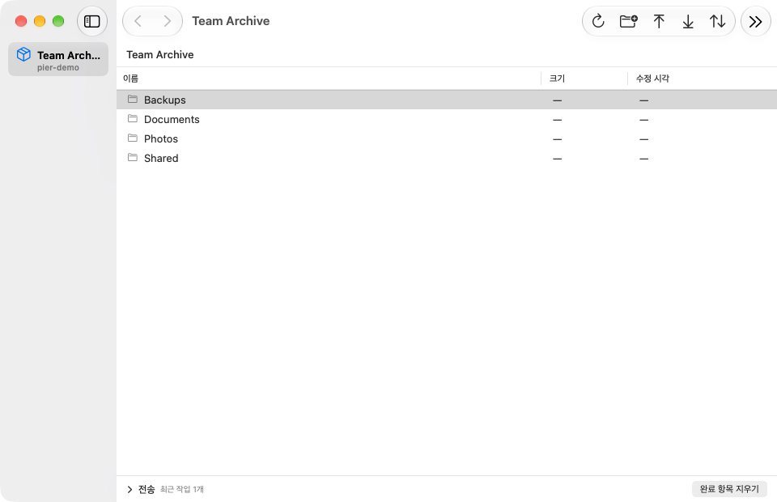
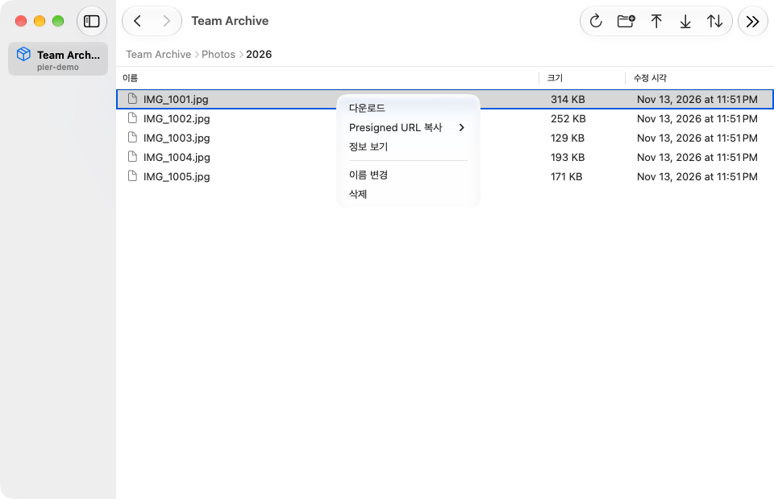
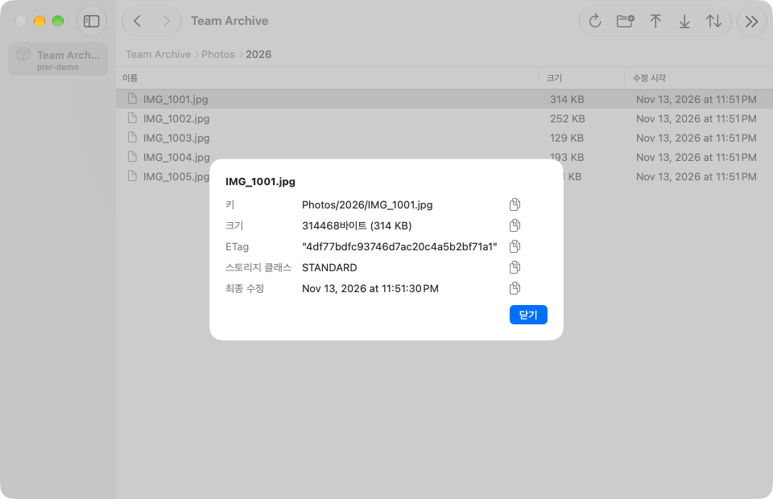
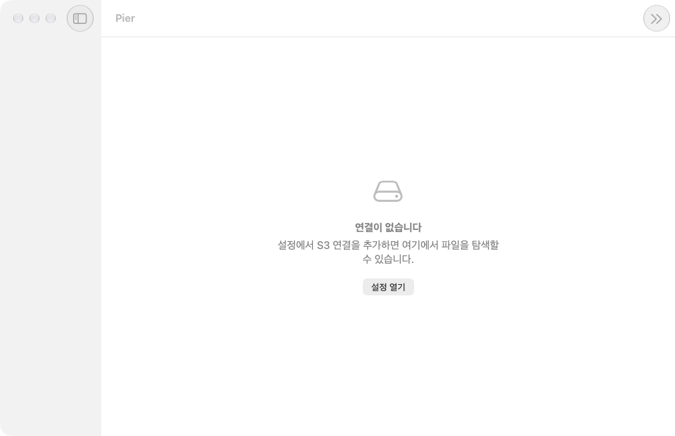

# Pier (가칭)

S3 호환 버킷을 탐색하고 파일을 주고받는 macOS 앱입니다. Finder와 드래그 앤 드롭으로 오가는 독립 창 앱이며, 메뉴바에서 전송 현황도 확인할 수 있습니다.



- 현재 버전: **0.1.0** (앱 이름은 가칭)
- 요구 사항: **macOS 14 이상, Apple Silicon**
- 라이선스: **MIT OR Apache-2.0**

## 주요 기능

### 연결 관리

- 서비스 프리셋: Amazon S3, Cloudflare R2, Wasabi, MinIO, S3 호환(커스텀). 프리셋별로 필요한 항목만 입력합니다 (R2는 계정 ID, MinIO/커스텀은 엔드포인트와 path-style).
- "연결 테스트"가 성공해야만 저장되며, 쓰기 권한이 없는 자격 증명은 "테스트 성공 — 읽기 전용 연결"로 표시되고 앱에서 읽기 전용으로 동작합니다.
- Secret Access Key는 macOS 로그인 키체인에만 저장합니다. 디스크의 연결 설정(`connections.json`)에는 시크릿이 들어가지 않습니다.



### 빠른 탐색

- 한 번 열어본 폴더는 SQLite 캐시에서 즉시 표시하고, 백그라운드에서 원격과 비교해 추가·변경·삭제를 반영합니다. 주기적 자동 폴링은 하지 않습니다.
- 최근에 본 폴더의 하위 폴더 목록을 미리 캐시(프리페치)해 다음 진입을 빠르게 합니다.
- 경로 표시줄(breadcrumb)과 뒤로/앞으로 이동을 지원합니다.



### 전송

- 대용량 파일은 병렬 범위 다운로드와 멀티파트 업로드로 대역폭을 채웁니다 (기본 청크 8MiB, 동시성 8).
- 전송 대기열이 동시 전송 수를 관리하고, 작업별로 일시정지/재개/취소/재시도할 수 있습니다. 다운로드는 일시정지 후 이어받기, 멀티파트 업로드는 중단 후 이어올리기를 지원합니다.
- 폴더를 통째로 업로드·다운로드할 수 있고, 업로드 시 `.DS_Store`, `._*`, `.localized` 등은 자동으로 제외합니다.
- 창 하단의 전송 패널(⌥⌘L)에서 "N개 진행 중 · 속도"를 보고 완료 항목을 지울 수 있고, 메뉴바 아이콘에서도 진행 중 전송과 합계 속도를 확인할 수 있습니다.



### 파일 작업

- 새 폴더(⇧⌘N), 이름 변경(Return), 이동(앱 안에서 폴더나 경로 표시줄로 드래그), 삭제(⌘⌫).
- 삭제는 확인 후 즉시 실행되며 휴지통으로 가지 않습니다.
- 같은 이름이 이미 있으면 덮어쓰기 대화상자가 뜹니다: 대치 / 둘 다 유지(`이름 (2).확장자`) / 건너뛰기 / 모두에 적용. 업로드 직전에 다른 클라이언트가 같은 키를 수정한 경우에도 다시 확인해 데이터 유실을 막습니다.



### macOS 연동과 S3 편의 기능

- **Finder 드래그 앤 드롭 양방향**: Finder에서 앱으로 파일·폴더를 드롭해 업로드하고, 앱에서 Finder로 끌어 놓으면 그 위치로 다운로드됩니다. 다중 선택을 지원합니다.
- **Quick Look**: 파일을 선택하고 스페이스바를 누르면 미리봅니다. 임시 캐시에 내려받아 `QLPreviewPanel`로 표시하고, 대용량 파일은 다운로드 진행률을 보여줍니다 (캐시는 ETag로 재사용, 1GB LRU).
- **Presigned URL 복사**: 우클릭 메뉴에서 만료 1시간/1일/7일을 골라 클립보드로 복사합니다.
- **정보 보기**: 키, 크기, ETag, 최종 수정 시각과 함께 스토리지 클래스를 HEAD 요청으로 가져와 표시합니다.



## 설치

[GitHub Releases](https://github.com/kwakchangkyoung/Pier/releases/latest)에서 최신 `Pier-<버전>.dmg`를 내려받습니다. 소스에서 직접 빌드하려면 아래 "소스에서 빌드"를 참고하세요.

1. 내려받은 DMG를 열고 `Pier.app`을 `Applications`로 드래그합니다.
2. 서명되지 않은 앱(ad-hoc 서명)이므로 첫 실행 시 Gatekeeper가 차단합니다.
   - **시스템 설정 > 개인정보 보호 및 보안**에서 "확인 없이 열기"를 눌러 열거나,
   - 터미널에서 `xattr -dr com.apple.quarantine /Applications/Pier.app`을 실행합니다.

## 사용 방법

### 연결 추가

1. 설정 창(⌘, 또는 사이드바의 톱니바퀴)을 열고 **새 연결**을 누릅니다. 첫 실행 시 연결이 없으면 "연결이 없습니다" 화면의 **설정 열기**로 바로 이동할 수 있습니다.

   

2. **서비스**를 고르고 필요한 항목을 입력합니다 — 표시 이름, 버킷 이름, 접두사(선택), Access Key ID, Secret Access Key. R2는 계정 ID를, MinIO/커스텀은 엔드포인트와 path-style을 입력합니다.
3. **연결 테스트**를 누릅니다. "테스트 성공"이면 저장할 수 있고, "테스트 성공 — 읽기 전용 연결"이면 읽기 전용으로 저장됩니다.
4. 연결을 지우면 키체인의 시크릿과 로컬 캐시도 함께 삭제됩니다.

### 탐색

- 폴더를 **더블클릭**하면 들어가고, 경로 표시줄이나 툴바의 뒤로/앞으로로 이동합니다.
- **⌘R**(또는 툴바 새로고침, 메뉴바 "현재 폴더 새로고침")로 원격 목록을 다시 받습니다.

### 업로드

- 툴바 **업로드** 버튼으로 파일·폴더를 고르거나, Finder에서 앱의 목록 영역으로 **드롭**합니다. 폴더와 다중 선택을 지원합니다.
- 같은 이름이 있으면 대치/둘 다 유지/건너뛰기를 고르는 대화상자가 뜹니다.

### 다운로드

- 항목을 선택하고 툴바 **다운로드** 버튼이나 우클릭 **다운로드**로 저장 폴더를 고르거나, 선택 항목을 **Finder로 드래그**해 드롭 위치로 바로 받습니다. 폴더는 하위 구조 그대로 `<선택한 폴더>/<폴더 이름>`에 저장됩니다.

### 그 외 조작

| 동작 | 방법 |
|---|---|
| 새 폴더 | ⇧⌘N 또는 툴바 "새 폴더" |
| 이름 변경 | 항목 하나를 선택하고 Return |
| 이동 | 항목을 폴더나 경로 표시줄 구간으로 드래그 |
| 삭제 | ⌘⌫ (휴지통 없이 즉시 삭제, 확인 대화상자 후 실행) |
| Quick Look | 파일 선택 후 스페이스바 |
| 전송 패널 열기/닫기 | ⌥⌘L 또는 툴바 "전송" |
| 새로고침 | ⌘R |

### 전송 설정 (고급)

연결 폼의 "고급" 섹션에서 프리셋 기본값(8MiB / 8)을 끄고 조정할 수 있습니다 — 청크 크기 5~512MB, 동시 전송 수 1~32.

## 소스에서 빌드

요구 도구: Rust stable (1.99 이상), Xcode (`xcode-select`로 활성화된 상태), [XcodeGen](https://github.com/yonaskolb/XcodeGen). Docker는 로컬 MinIO 테스트에만 필요합니다.

```bash
# Rust 코어 → XCFramework + Swift 바인딩
./scripts/build-core.sh

# Xcode 프로젝트 생성 후 빌드 (로컬은 서명 없이)
cd apple && xcodegen generate && cd ..
xcodebuild -project apple/Pier.xcodeproj -scheme Pier \
    -configuration Debug CODE_SIGNING_ALLOWED=NO build

# 배포 패키지 (코어 release 빌드 → xcodebuild Release → ad-hoc 서명 → DMG)
./scripts/package.sh        # dist/Pier-0.1.0.dmg 생성
```

## 개발·테스트

```bash
# 로컬 MinIO 실행과 테스트 데이터 시드
docker compose -f docker/compose.yml up -d
./scripts/seed-minio.sh

# Rust 검증
cargo fmt --all --check
cargo clippy --workspace --all-targets -- -D warnings
cargo test --workspace                  # 단위 테스트만
PIER_TEST_MINIO=1 cargo test --workspace  # MinIO 통합 테스트 포함
```

### S3 호환성 검사

```bash
./scripts/compat-test.sh          # 로컬 MinIO 대상
./scripts/compat-test.sh --big    # 5GB 초과 복사까지

# 다른 서비스를 직접 검증할 때 (키는 환경변수로만, 테스트 객체는 접두사 아래에만 생성 후 정리)
PIER_TEST_BUCKET=<버킷> PIER_TEST_REGION=<리전> \
PIER_TEST_ENDPOINT=<엔드포인트> \
PIER_TEST_ACCESS_KEY=<키> PIER_TEST_SECRET_KEY=<시크릿> \
./scripts/compat-test.sh
```

### 성능 측정

```bash
./scripts/bench.sh    # 로컬 MinIO 대상 Pier / aws s3 cp / rclone 처리량 비교
```

`BENCH_SIZE_MB`, `BENCH_RUNS`, `BENCH_TOOLS`, `PIER_CHUNK_MB`, `PIER_CONCURRENCY`로 조건을 바꿀 수 있습니다.

## 호환성과 성능

- **호환성**: MinIO에서 실측으로 11개 기능(목록·페이지네이션, 범위 읽기, 멀티파트 업로드, 이어올리기, 서버 측 복사, 5GB 초과 복사, 배치 삭제, 조건부 쓰기, presign, 스토리지 클래스)이 모두 통과했습니다. Amazon S3, Cloudflare R2, Wasabi는 각 서비스 공식 문서 기준이며 **실계정으로는 검증하지 않았습니다**. 항목별 표와 알려진 위험은 [docs/COMPATIBILITY.md](docs/COMPATIBILITY.md)를 참고하세요.
- **성능** (로컬 MinIO, 1GiB 파일, 중앙값): Pier 업로드 454.3 MB/s · 다운로드 681.3 MB/s로, `aws s3 cp` 대비 각각 171.5% / 144.0%였습니다. **실제 클라우드 대상 측정은 아직 없습니다** — 모든 트래픽이 Docker VM 내부를 도는 조건입니다. 측정 환경·방법·원시 결과는 [docs/PERFORMANCE.md](docs/PERFORMANCE.md)를 참고하세요.

## 구조

```text
┌─────────────────────────────────────────────┐
│ SwiftUI 앱 (apple/PierApp)                   │
│  창 + 메뉴바 + 설정 · 키체인 · 드래그/드롭 · Quick Look │
└──────────────▲──────────────────────────────┘
               │ UniFFI (async API + 콜백)
┌──────────────┴──────────────────────────────┐
│ pier-ffi (crates/pier-ffi)                   │
└──────────────▲──────────────────────────────┘
               │
┌──────────────┴──────────────────────────────┐
│ pier-core (crates/pier-core) — 순수 Rust     │
│  OpenDAL(데이터 경로) · s3_raw(S3 직접 서명)  │
│  SQLite 메타데이터 캐시 · 목록 갱신 · 전송 대기열 │
└─────────────────────────────────────────────┘
```

- **판단은 Rust, 연결은 Swift.** S3 통신, 캐시, 덮어쓰기 판단, 전송 로직은 모두 코어에 있고, Swift는 macOS API와 코어를 잇는 얇은 층입니다.
- `pier-core`는 Apple 플랫폼에 의존하지 않아 `cargo test`와 CLI 예제(`cargo run -p pier-core --example cli`)만으로 검증할 수 있습니다.

## 보안·개인정보

- Secret Access Key는 로그인 키체인(`kSecClassGenericPassword`)에만 저장하고, 연결을 열 때만 코어에 전달합니다. 디스크·SQLite·에러 메시지에 남기지 않습니다.
- 로그(통합 로그 subsystem `com.gajago.pier`)에 액세스 키, 시크릿, presigned URL 전체 값을 기록하지 않습니다.
- App Sandbox는 사용하지 않습니다.
- 수집하는 데이터는 없습니다. 모든 통신은 설정한 S3 엔드포인트와만 이뤄집니다.

## 알려진 제약

- 전송 대기열은 앱 종료 시 사라집니다. 중단된 멀티파트 업로드는 다음 실행 때 정리됩니다.
- 객체가 매우 많은 폴더(수만 개 이상)는 첫 화면 표시가 전체 목록 수신 시간만큼 걸립니다.
- 폴더 이름 변경은 하위 객체가 1,000개를 넘으면 거부됩니다.
- 서명되지 않은 배포(ad-hoc 서명)라 첫 실행 시 Gatekeeper 확인이 필요합니다.
- 앱 이름은 가칭이며, ad-hoc 서명 개발 빌드는 재빌드 후 키체인 접근 허용 대화상자가 다시 뜰 수 있습니다.

## 라이선스

[MIT](LICENSE-MIT) 또는 [Apache-2.0](LICENSE-APACHE) 중 선택할 수 있는 이중 라이선스입니다.
